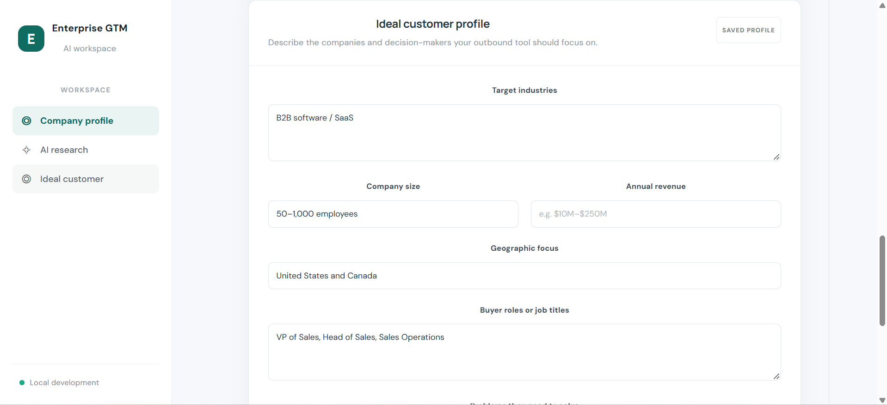

# Enterprise GTM AI

A local portfolio prototype of an AI-assisted go-to-market workspace for B2B sales teams. It is not ready for public deployment or real customer data.

## Current features

- Start from an agency command-center home page with direct views for prospecting, messaging automation (email, LinkedIn, and WhatsApp), calling by market, company/ICP setup, CRM integrations, and agency/client reports. Create and switch the agency or client workspaces from the home page.
- Give the AI prospecting agent a plain-language prompt to research up to five likely-fit companies using the selected client's saved offer and ideal-customer profile. Add optional country, state/province, city, or local-area filters per search. Results include an evidence-based fit score, relevant public buying signals, a likely decision-maker, source-backed public contact details, and an editable personalized email draft. Selectively save researched companies and named contacts to the workspace; public emails are never guessed and remain unverified.
- Automatically save each prospect search, its locations, results, editable drafts, and selected leads under the active client. Reopen and edit a saved search without rerunning AI research.
- Review an agency overview and separate client reports covering saved searches, target companies, qualification, contact coverage, sourced reasons, call activity, email outcomes, and reported AI token/search usage. Dollar spend is not calculated; suggestions use only saved workspace data.
- Show each researched buying signal's category, date stated by its source, direct source link, and model-estimated evidence confidence. Older saved searches identify those fields as not recorded.
- Create, load, and update company profiles.
- Research company profiles with AI, review suggestions, and apply them manually.
- Create and update ideal customer profiles (ICPs).
- Draft and save an organization-specific outbound strategy using the company profile and ICP as a starting point.
- Review target-account ICP-fit status, contact coverage, and recorded email-verification status alongside the strategy.
- Plan a small, saved pilot using up to five currently ICP-qualified accounts and editable, non-sending touchpoint outlines.
- Prepare and edit local email draft shells for selected pilot accounts; drafts can only be marked reviewed after bracketed placeholders are replaced and an HTTP(S) source is recorded for the account-specific reason. Edits reset the review status.
- Add and edit target companies manually, import up to 100 from CSV or Excel `.xlsx` files, and export a client workspace's companies plus saved contacts, their do-not-contact/email/lead statuses, and evidence links as CSV or Excel. Downloadable CSV and Excel templates show the supported columns. Contacts can be imported from the same export format when their company already exists in the workspace; duplicates are skipped.
- AI prospecting is grouped into company research, account-based marketing planning, target-company lists, decision-maker contacts, and research-source setup. Messaging automation groups email, LinkedIn, and WhatsApp; email retains reviewed sending, while LinkedIn and WhatsApp currently prepare editable drafts and open the external account for manual handoff. Their business/API accounts are not connected to the app and it does not send those messages.
- Calling now starts with clear market choices for the US, Gulf countries, Malaysia, UK, and India. A saved phone number can be called through the user's phone app without a provider connection; provider-powered calls appear after that market's Twilio, Unifonic, or Exotel setup is saved.
- Saved contacts and researched prospects show quick email, LinkedIn, and WhatsApp actions beside the person's name whenever the matching detail is available. WhatsApp opens a chat for the saved phone number; do-not-contact records have no outbound shortcuts.
- Connect a HubSpot private app separately to each client workspace. Manually sync saved companies and contacts to HubSpot; existing companies are matched by website domain (or exact name when no domain is available) and contacts by email. Duplicate company matches pause the sync, contacts without email are skipped, and local do-not-contact contacts are flagged as email opt-outs in HubSpot. This initial connector pushes records only; it does not import CRM records or delete remote data.
- Add decision-maker contacts and track email and qualification status.
- Log manual calls per client, open saved phone numbers in the user's phone app, record outcomes and notes, manage due follow-ups, and mark a contact do not contact. Prepare an AI call guide from the selected client's saved offer, ICP, prospect evidence, and contact role. For India, an optional Exotel adapter can ring the agent's phone, then call the prospect, and stream live captions to the app. The user can ask for a reply suggestion from the latest caption; it is never spoken automatically. Calls placed this way require an explicit notice confirmation and are blocked for do-not-contact contacts. The app does not request call recording or save call audio/transcripts to the database. Exotel credentials and a secure public WebSocket address are required before this path can be used. Manual phone-app dialing and note-based assistance remain available. These actions may use provider/OpenAI credits. Gmail sends are blocked when a selected recipient matches a saved do-not-contact contact in that client workspace.
- Sign in with Google and limit client organization data to active members (requires local OAuth setup; local development can opt in with `GOOGLE_AUTH_REQUIRED=true`).
- When a prompt explicitly asks to send, stage the researched emails and offer Gmail or a private-environment-configured SMTP mailbox. The app displays the exact recipients, subject, message, and public email source for a final confirmation before sending. Gmail credentials are encrypted at rest, and sent/failed/uncertain outcomes are recorded in the active client workspace. It does not read the inbox or guess email addresses.

The AI prospecting request and call-assistance requests use OpenAI and may use API credits. Exotel live calls also incur provider charges, and transcription is an OpenAI Realtime service. To enable Exotel for a client, connect that client's credentials in the call queue and set `EXOTEL_PUBLIC_WS_BASE` in `.env` to a secure public WebSocket tunnel address that routes to the backend. A regular local URL is not reachable by Exotel. Do not place real calls until credentials, caller ID, destination phone, and required call notice are ready. Email sending requires confirmation of the exact messages. Gmail is the default temporary sender. A future domain mailbox can use SMTP by setting `OUTBOUND_EMAIL_PROVIDER=smtp` and its SMTP settings in the private `.env`; do not commit or share mailbox credentials. Gmail access and refresh tokens are encrypted in the local database, and each send result is recorded by client workspace; message bodies are not retained in the send history. Set a stable `GMAIL_TOKEN_ENCRYPTION_KEY` of at least 32 characters in `.env`; if it is blank, the app derives the encryption key from `SESSION_SECRET`, which must remain stable across restarts. Losing or changing the encryption key means Gmail must be connected again. This local prototype still needs production security review. The app does not read the inbox or verify deliverability. No registered company name or website is required for prompt-led prospect research; a personal Gmail address can be used as the sender. Outbound strategy suggestions are working assumptions for review, not market predictions. The dummy workspaces `micro1`, `SummitOps Cloud`, and `Northstar ERP` were removed from the local database with their linked data.

## Technology

- Frontend: React, TypeScript, Vite
- Backend: Python, FastAPI, SQLAlchemy
- Database: PostgreSQL, managed with Alembic migrations
- Optional AI research: OpenAI API with web search

## Requirements

- Windows, PowerShell, Node.js, and npm
- Python 3.13 (available on this computer as `python3.13`)
- PostgreSQL

## Configure the local environment

From the project root, copy `.env.example` to `.env` and set the PostgreSQL connection values. To enable Google sign-in, set `GOOGLE_CLIENT_ID` and `GOOGLE_CLIENT_SECRET` as described below. To use AI research, also set `OPENAI_API_KEY`. Research sends saved company profile details to the OpenAI API, and API usage charges may apply.

Keep `.env` private. Do not commit or share API keys. AI prospect research sends the prompt to the OpenAI API, which may incur charges.

## Configure Google sign-in

Create a Web application OAuth client in the [Google Cloud Console](https://developers.google.com/identity/openid-connect/openid-connect). Add this exact authorized redirect URI:

```text
http://127.0.0.1:8000/auth/google/callback
```

Put the resulting client ID and client secret in `.env` as `GOOGLE_CLIENT_ID` and `GOOGLE_CLIENT_SECRET`. If the OAuth consent screen is in testing mode, add the Google account you will use as a test user. `FRONTEND_URL` must match the Vite port (currently `http://127.0.0.1:5176`). Restart the backend after changing `.env`.

The local app defaults to single-user development mode. To require Google sign-in locally, set `GOOGLE_AUTH_REQUIRED=true` in `.env` and restart the backend. The first Google account to sign in becomes owner of existing local demo organizations so their saved data stays accessible. Set it back to `false` to return to single-user development mode. Production always uses authenticated sessions.

Regular sign-in requests Google OpenID Connect scopes (`openid`, `email`, and `profile`). Before connecting Gmail, add `https://www.googleapis.com/auth/gmail.send` under Google Auth Platform → Data Access. Gmail sending is separate and requests that send-only scope only after the user selects “Connect Gmail for sending.” Google may require the account to be listed as a test user while the OAuth consent screen is in testing mode. The first Google account to sign in becomes the owner of existing local demo organizations in development. Later users can access only organizations where they have an active membership. Organization invitations and per-role restrictions are not implemented yet.

## Start the backend

Use a PowerShell terminal in the project root:

```powershell
python3.13 -m venv .venv
.\.venv\Scripts\python.exe -m pip install -r backend\requirements.txt
.\.venv\Scripts\python.exe -m alembic -c .\alembic.ini upgrade head
.\.venv\Scripts\python.exe -m uvicorn app.main:app --app-dir backend --reload
```

Create `.venv` only if it does not exist. Install or update dependencies with the pip command whenever `backend\requirements.txt` changes. Keep the Uvicorn command running in this terminal. The backend API is at `http://127.0.0.1:8000`.

After setup, you can also double-click [scripts/start-backend.cmd](scripts/start-backend.cmd). It applies pending database migrations and then starts the backend. Keep its window open while using the app.

Python 3.13 is installed on this computer through WindowsApps. The Codex-managed terminal currently cannot launch that WindowsApps interpreter, even though it is installed. If `.venv\Scripts\python.exe` is blocked in this terminal, run the backend commands from a regular Windows PowerShell window. Do not activate the virtual environment; invoking its Python executable directly avoids PowerShell activation-policy issues.

## Start the frontend

Open a second PowerShell terminal:

```powershell
Set-Location .\frontend
npm.cmd install
npm.cmd run dev -- --host 127.0.0.1 --port 5176 --strictPort
```

Use `npm.cmd` in PowerShell to avoid the `npm.ps1` execution-policy error. This command uses port 5176, matching the backend CORS and Google sign-in settings. You can also double-click [scripts/start-frontend.cmd](scripts/start-frontend.cmd). Open `http://127.0.0.1:5176` in your browser.

## Demo

The historical [demo walkthrough](docs/demo-walkthrough.md) refers to the deleted `micro1` sample and is not runnable against the current local database. For current implementation status and proposed remaining work, see [the project status and roadmap](docs/project-status-and-roadmap.md).

For a short-lived shareable preview, see [private staging deployment](docs/private-staging-deployment.md). Do not deploy real client records; external-client onboarding and full SaaS security review are still pending.

## Application screenshot


